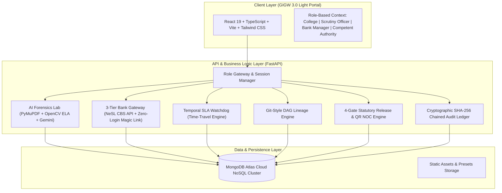

# VidyaKosh — Technical Architecture Deep Dive

## System Architectural Topology

---

## 1. Tri-Party Dual-Truth Data Architecture
In traditional government portals, an institution uploads a scan and types in an amount, and officers manually eyeball it. VidyaKosh separates each instrument record into three isolated, authoritative columns stored within MongoDB documents:

1. **`inst_declared` (Column Set A)**: Self-submitted particulars declared by the College Principal.
2. **`ocr_extracted` (Column Set B)**: Machine-verified facts extracted via Google Gemini GenAI, OpenCV Error Level Analysis (ELA), and perceptual hashing.
3. **`bank_confirmed` (Column Set C)**: Authoritative core banking truth received through direct Core Banking API (NeSL/SFMS) or Cryptographic Zero-Login Magic Link.

---

## 2. Forensic Pixel Analysis & Mathematical Verification

### Error Level Analysis (ELA)
$$ELA = | Original - Recompressed_{Quality=90} | \times Scale$$
- Genuine scans show uniform compression artifacts across the canvas (ELA score $< 0.10$).
- Digitally edited numbers (e.g. changing ₹15 Lakhs to ₹35 Lakhs in Photoshop) introduce high-contrast compression disparities (ELA score $> 0.80$), generating an instant tamper heatmap overlay.

### Compound Interest Formula Verification
$$A = P \times \left(1 + \frac{r}{400}\right)^{4 \times t}$$
- Fixed Deposits in Indian Scheduled Commercial Banks compound quarterly.
- If a certificate claims a principal of ₹35,00,000 at 6.5% interest maturing after 10 years to ₹30,80,000, the mathematical model flags an anomaly because ₹30.8 Lakhs is the yield of a ₹15 Lakh deposit, exposing forged principal text.

### Perceptual Hashing (pHash)
- Generates 64-bit DCT perceptual hash fingerprints for every uploaded scan.
- Cross-references across all institutions to flag duplicate scan recycling (Hamming distance $\le 3$).

---

## 3. Git-Style Directed Acyclic Graph (DAG) Lineage
During the 10-year lock-in period, institutions often face bank mergers (e.g., Syndicate Bank amalgamating into Canara Bank) or required statutory 5-year maturity renewals. 

VidyaKosh models the deposit lifecycle as a Directed Acyclic Graph:
- **Root Node**: Genesis fixed deposit filed at initial college approval.
- **Child Nodes**: Replacements issued post-merger or renewals.
- Parent nodes are transitioned to `RENEWED_SUPERSEDED` while preserving historical scans, OCR metadata, and audit logs.
- Interactive graph rendering using `React-Flow` with customizable nodes and directional edges.

---

## 4. 4-Gate Statutory Release & QR-Verifiable Discharge NOC
To release the joint lien upon lock-in maturity, an application must clear 4 sequential gates:
- **Gate 1**: Continuous Statutory Lock-in (8–10 continuous years across unbroken DAG lineage + clean CBS lien).
- **Gate 2**: Cross-Bureau Regulatory Compliance (Zero active court cases, 0 unpaid faculty salary grievances, 0 PGRC student fee penalties, 0 EVC deficiencies).
- **Gate 3**: Regional Scrutiny Officer verification and formal sign-off.
- **Gate 4**: Competent Authority (Member Secretary, AICTE) Digital Signature Certificate (DSC) authorization.

Upon Gate 4 clearance, a cryptographically signed Discharge NOC is minted with an embedded verification URL and SHA-256 certificate digest.
